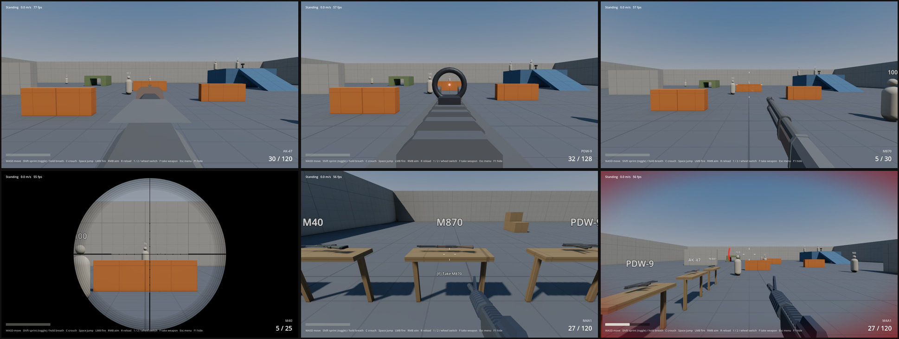

# Shooter

A multiplayer first-person shooter built on Godot 4.7, with gameplay code written in Rust. It runs on the Forward+ renderer with Jolt physics.

The plan, decisions, and reference projects are in [docs/roadmap.md](docs/roadmap.md). Open tasks for contributors are in [TODO.md](TODO.md).





## Layout

- `godot/`: the Godot project (scenes, GDScript glue, assets).
- `godot/assets/characters/`: the soldier model and its texture atlas, the first-person arms, the animation sets (all built by `tools/build_character_assets.py`), and the bone maps that retarget them to Godot's humanoid skeleton. `godot/scenes/characters/` holds the third-person soldier and the first-person arms.
- `godot/data/weapons/`: one RON file per weapon (damage, fire rate, recoil pattern, spread, reload style, pellets, scope). Edit a file while the game runs from a debug build and it reloads.
- `rust/sim/`: engine-independent, deterministic simulation: Zombies rules (`zombies.rs`: rounds, horde size and health, gaits, the straight-line chase, attacks, the two-hit rule, points), movement, weapons (fire rate, falloff, recoil patterns, spread, pellets, bolt and pump cycling, magazine and shell-by-shell reloads, ADS, scope sway and hold breath, switching, pickups), health (regeneration, fall damage, death), equipment (`equipment.rs`: the frag grenade's cook and throw, its flight, bounces, and blast, the flashbang's blinding and the smoke cloud's growth and what it hides, and counts per mode), hit zones (head, chest, stomach, arms, legs, posed from stance and view angles, with damage multipliers), the combined per-player step that the client predicts and the server runs, and gamepad look (stick shaping, aim assist). `rust/sim/src/net/` holds the netcode core: the bit-packed wire protocol with delta compression, the server's input queue (with an input rate cap), client prediction and reconciliation, snapshot interpolation, lag compensation (hitbox history, rewind, and shot resolution), a network condition simulator, and server discovery (`discovery.rs`: the query and master server packets, and the browser's logic). No Godot types, so the client and the dedicated server share it and it can be unit-tested on its own.
- `rust/game/`: the GDExtension that exposes the simulation to Godot: `FpsPlayer` (input, gamepad look and aim assist, hitscan, tracers, footsteps, camera, prediction), `AimAssistTarget`, `ViewmodelRig` and `WeaponView` (procedural weapon motion, muzzle flash, ejected shells, sounds), `WeaponPickup` (weapon racks), `Sentry` (a turret that shoots back), `TargetDummy` (an armed soldier), `Zombie` and `ZombieDirector` (Zombies mode), the characters in `rust/game/src/character/` (`SoldierRig` with its animation tree, `SoldierPoser` for aim and hand IK, the hand-pose fitter in `grasp.rs`, ragdoll deaths and the `CorpseYard` where bodies and dropped guns lie, `FpArms`, team palettes), `HitboxRig` (hit zones as physics shapes, F4 overlay), and networking in `rust/game/src/net/`: `NetServer` (the dedicated server, which also resolves every shot, applies damage, and keeps score), `NetClient`, `RemotePlayer` (other players, interpolated), and `ServerBrowser` (finds servers for the server browser; the server side answers its queries). Sound: see [Sound](#sound).
- `rust/master/`: `shooter-master`, the master server that lists dedicated servers for the in-game server browser.
- `rust/launcher/`: `shooter-launcher`, which keeps the latest nightly build installed and starts it, and keeps a dedicated server on the latest build (see [Play the latest build](#play-the-latest-build)).
- `godot/shaders/`: viewmodel projection (own FOV, never clips walls), muzzle flash, damage vignette, the lens pass, and the blockout grid.
- `godot/scripts/`: GDScript for the HUD, scope and damage overlays, pause and settings menu (`Settings` autoload), graphics presets (`graphics.gd`), each map's graded look (`looks.gd`), the lens pass (`lens.gd`), the title screen and server browser, impacts, tracers, and the `Net` autoload that starts a server or client from command-line options or the server browser (`godot/scripts/net/`).
- `docs/`: roadmap, [art direction](docs/art-direction.md) (the look, the character pipeline, hit zones), and design notes.
- `tools/map_blockout/`: draws, measures, and renders map layouts before they are built (walking times, sightlines, a minimap), and fetches the Call of Duty minimaps we study for reference into a local folder. See [docs/map-design.md](docs/map-design.md).
- `tools/build_weapon_audio.py`: builds the layered gunshot sounds and the weapon handling foley from bart's CC0 firearm library and trims dead air from the other sounds. Run it with `uv run`; its docstring explains the steps. `docs/audio.md` describes the sound system.
- `tools/audio_report.py`: spectrograms, waveforms, and loudness tables of sounds, and layer timelines, for reviewing audio without listening.
- `tools/build_world_audio.py`: builds the grass, carpet, gravel, and tile footsteps and the glass impacts from CC0 packs, and synthesizes the ambience loops (`uv run`; see its docstring).
- `tools/build_textures.py` and `tools/build_skies.py`: the CC0 world texture library and sky images (run with `uv run`). `tools/bake_lightmaps.sh`: bakes each map's lightmaps (needs a GPU). `tools/build_props.py`: builds the map props from CC0 Poly Haven models in Blender. `tools/build_weapons.py`: rebuilds the guns as PBR models in Blender (`blender -b --python tools/build_weapons.py`; needs Blender 4.2+ with numpy). See [docs/art-direction.md](docs/art-direction.md).
- The UI theme is `godot/scripts/ui/ui_theme.gd` (colours, Chakra Petch and Barlow type, and a style for every control), applied to every screen by the `UiThemeLoader` autoload; `godot/tests/capture_ui.gd` captures every menu and HUD for review. The pause and settings menu (`godot/scenes/ui/pause_menu.tscn`, Esc in game, **Options** on the title screen) fills the screen over a blur of the game: settings sit in five tabs (Controls, Keybinds, Graphics, Audio, General; LB/RB or Page Up/Down switch), and a pane beside the list explains the focused setting and shows its default.
- `tools/build_character_assets.py`: builds the soldier from a CC0 MakeHuman body and clothes (through MPFB 2 in Blender) fitted to the game's skeleton, with kit modelled by `tools/blender_gear.py` (helmet, glasses, face coverings, plate carrier, belt and holster, pads), all baked into one texture atlas; the first-person arms; and the trimmed animation sets from Quaternius's CC0 Universal Animation Library. Run it with `uv run`; see [docs/art-direction.md](docs/art-direction.md).

## Play the latest build

Every merge to `main` publishes a build to the [nightly release](https://github.com/JedBorseth/shooter/releases/tag/nightly). The Shooter launcher installs it for you: each time you start it, it checks for a newer build, downloads it if there is one (about 300 MB), checks it, and starts the game. Without a connection it starts the build you already have. You do not need Git, Rust, or Godot.

- **Windows:** download [shooter-launcher-windows-x86_64.exe](https://github.com/JedBorseth/shooter/releases/download/nightly/shooter-launcher-windows-x86_64.exe) and double-click it. The first time, Windows says it protected your PC because the launcher is not signed: click **More info**, then **Run anyway**.
- **macOS** (Apple Silicon or Intel), in Terminal:

  ```sh
  curl -fLo ~/shooter-launcher https://github.com/JedBorseth/shooter/releases/download/nightly/shooter-launcher-macos-universal
  chmod +x ~/shooter-launcher && ~/shooter-launcher
  ```

  Start it again with `~/shooter-launcher`. Downloading with `curl` keeps macOS from blocking the unsigned launcher.
- **Linux** (x86_64):

  ```sh
  curl -fLo ~/.local/bin/shooter-launcher https://github.com/JedBorseth/shooter/releases/download/nightly/shooter-launcher-linux-x86_64
  chmod +x ~/.local/bin/shooter-launcher && shooter-launcher
  ```

The launcher updates itself too. Builds are kept in `%LOCALAPPDATA%\Shooter` (Windows), `~/Library/Application Support/Shooter` (macOS), or `~/.local/share/shooter` (Linux): the current build and the one before it. Options:

| Option | What it does |
| --- | --- |
| `--offline` | Start the installed build without checking for a new one. |
| `--previous` | Start the build before the current one, if the latest is broken. |
| `--dir PATH` | Keep builds somewhere else (`SHOOTER_DIR`). |
| `--manifest URL` | Follow builds published somewhere else (`SHOOTER_MANIFEST`): a URL or a path to a `latest.json`. |
| `-- ARGS` | Pass the rest to the game, for example `shooter-launcher -- --connect 10.0.0.5`. |

A server that runs a newer build turns older games away; the server browser marks it **Newer version**. Restart the launcher to update. To run a dedicated server that updates itself, see [Run a server that stays up to date](#run-a-server-that-stays-up-to-date).

If you work from a source checkout instead, `tools/dev-sync.sh` pulls, fetches the LFS assets, rebuilds the Rust code, reimports the assets, and starts the game in one step (`--no-run` to skip starting it; `GODOT=/path/to/godot` if Godot is not on your PATH).

## Set up a Linux playtest machine

1. Install a current GPU driver with Vulkan support (NVIDIA proprietary driver, or Mesa for AMD and Intel). `vulkaninfo --summary` should list your GPU.
2. Install Rust: `curl --proto '=https' --tlsv1.2 -sSf https://sh.rustup.rs | sh`.
3. Install Godot 4.7.2 (standard build, no .NET) from the [4.7.2 release page](https://github.com/godotengine/godot/releases/tag/4.7.2-stable). Unzip it and put the binary on your PATH as `godot`.

## Set up a Mac playtest machine

1. Install Apple's command-line tools with `xcode-select --install` if needed.
2. Install a stable Rust toolchain from [rustup](https://rustup.rs/).
3. Download the standard macOS universal build of Godot 4.7.2 from the [release page](https://github.com/godotengine/godot/releases/tag/4.7.2-stable), unzip it, and move `Godot.app` into `~/Applications`.

From the repository root, build and launch:

```sh
(cd rust && cargo build)
"$HOME/Applications/Godot.app/Contents/MacOS/Godot" --editor --headless --path godot --import
"$HOME/Applications/Godot.app/Contents/MacOS/Godot" --path godot
```

The universal Godot app supports Apple Silicon and Intel Macs; Cargo builds the extension for your Mac's architecture. The first build and asset import can take a few minutes. For later runs, use the last command. Add `--editor` to open the project in the editor.

## Build and run

Requirements: Godot 4.7.2+ (standard build, no .NET), a stable Rust toolchain, and [Git LFS](https://git-lfs.com) (models, textures, and audio are stored in LFS). Run `git lfs install` once before you clone, or `git lfs pull` in an existing clone.

```sh
cd rust && cargo build          # builds rust/target/debug/libshooter_game.*
cd .. && godot --path godot     # run the game
godot --editor --path godot     # open the editor
```

Rebuild with `cargo build` after changing Rust code. The editor hot-reloads the extension.

Launch opens a lightweight title menu over a still of Slamcity, with its routes in three
groups: matches against bots, online and co-op, and practice. Focus starts on **Team Deathmatch**;
the line under the menu says what the focused route does. A match mode opens its setup as a card
beside the menu: a picture of the chosen map and a row of choice chips per rule, then
**Start match**. **Team Deathmatch** sets up a local match (your name, the
map, team size from 1v1 to 6v6 with bots in the empty places, bot skill, score limit, and time limit),
starts a dedicated server for it in the background, and joins it; leaving the match stops
that server. **Gun Game** does the same for a free-for-all up a ladder of eight weapons
(your name, the map, 2 to 12 players, bot skill, kills per weapon, and time limit; see
[Gun Game](#gun-game)). **Capture the Flag** does the same for two teams scoring captures (see
[Capture the Flag](#capture-the-flag)). **Hardpoint** does the same for two teams fighting over one zone at a time: hold
it to score a point a second while nobody from the other team is in it; it moves every minute (see
[Hardpoint](#hardpoint)), and **Search and Destroy** for rounds with one life each on Slamcity
(your name, team size, bot skill, and rounds to win; see
[Search and Destroy](#search-and-destroy)). **Slamcity** is the team map, city blocks round an elevated station at dusk, laid
out from a study of real Call of Duty maps (see [docs/map-design.md](docs/map-design.md)). Each team
spawns in a bus depot on its own edge, and three routes join them: Slam Avenue into Junction
Plaza, where a derailed El car lies across the paving under the platforms; the north street
through the pawn shop into the far market; and the market through the ticket hall into the
far south street. The tenement, bodega, diner, record store, and subway hall link the routes,
and each team has a stair up to its own platform, with a stalled train as the way across.
Red's half is Blue's turned half round, dressed as different places (a hotel, a laundromat,
the ticket hall). Offline it has
practice targets on the far half. It ships in every build. **Testing Area** loads the
training range: an armoury line, a control tower, target stands and steel, and cover to
practise movement on. **Server Browser** opens the server browser (see [Play online](#play-online)). **Zombies**
opens a Black Ops 2 inspired menu: **Solo** leads to a rotating globe with five
selectable map locations. Use the list, map markers, or arrow buttons to select;
drag the globe to rotate, and use Back or Esc to return. **START GAME** loads the
Zombies arena; every map plays in that arena for now. Zombies assets load only on
menu entry. Use the mouse or press Enter to select the focused menu option.

### Zombies

Survive rounds of zombies in a walled yard at night. Each round sends more zombies
(6, 8, 13, 18, 24, then five more per round), with more health (150 in round 1, 100
more each round to round 9, then 10% more per round). Everyone walks in round 1 to
3; joggers join from round 4 and runners from round 7, all slower than your sprint.
Zombies always walk in a straight line at you and slide along whatever is in the
way; ones that spawn in a side yard walk to its gate first, and ones that walk into
a wall head for the open gate on the shortest way to you. Up to 24 are alive at once.

Zombies spawn outside the walls and climb in through eight boarded windows, tearing
off one board a second or so. Look at a damaged window and press F to put a board
back: 10 points a board, up to 300 a round. Bullets pass between the boards. Zombies
groan as they come, snarl when they swing, and a sting marks each round.

A zombie that reaches you swings. The first hit takes half your health and the
second kills you, unless your health has fully regenerated in between. There is no
respawn: death ends the match and shows how many rounds you survived, with
**Play again** and **Main menu**. Hits pay 10 points, kills 60, and headshot kills
100; you start with 500 and an M4. Spend points with F:

- **Wall weapons:** the tables on the north wall sell the M1911 (500), M870 (900),
  PDW-9 (1000), and M4A1 (1200); the side yards add the AK-47 (1400) and M40 (1500).
  Ammo for a gun you carry costs half.
- **Debris:** the gates in the west and east walls are piled with debris; clearing it
  (750 west, 1000 east) opens that yard, its wall weapon, and its zombie spawns.
- **Power-ups:** a kill sometimes drops one (at most four a round), glowing green
  for 30 seconds: Max Ammo, Insta-Kill (any hit kills for 30 seconds), Double Points
  (30 seconds), and Kaboom (kills every zombie and pays 400).

The T refill key is off in this mode. Esc opens the pause menu.

## Test

With [`just`](https://github.com/casey/just) installed, `just ci` runs what CI
checks (formatting, lints, Rust tests, and every headless Godot test), and
`just` lists the other recipes: `build`, `run`, `server`, `test-one NAME`,
`screens`, and `bench`. By hand:

```sh
cd rust && cargo test && cargo clippy --all-targets
cd .. && godot --headless --path godot --script res://tests/smoke_test.gd
godot --headless --path godot --script res://tests/slamcity_test.gd
godot --headless --path godot --script res://tests/settings_test.gd
godot --headless --path godot --script res://tests/title_screen_test.gd
godot --headless --path godot --script res://tests/zombies_menu_test.gd
godot --headless --path godot --script res://tests/zombies_test.gd
```

The Zombies test loads the arena and checks that zombies spawn, walk straight at the player at their round's speed, can be shot for points, that clearing round 1 starts round 2, and that exactly two zombie hits end the match with no respawn. `godot/tests/zombies_capture.gd` takes reference screenshots on a GPU (set `CAPTURE_DIR`).

The smoke test loads the arena headless and drives the player through movement (toggle sprint, slide, crouch), combat (aim, fire, kill a dummy, reload, switch), the characters (first-person and third-person hands on the grip, every hit zone, headshot and leg damage), a weapon rack, the shotgun (pellets, pump, shell-by-shell reload), the sniper (scope, hold breath), damage, regeneration, death and respawn, fall damage, the sentry, and gamepad look with aim assist. The settings test checks the menu and that settings save and load. Both exit non-zero on failure.

The movement test (`godot/tests/movement_test.gd`) drives the player body on a flat floor through crouching, standing, sliding, chained slide-cancels, and ladders, and checks the timings and speeds against the reference in [docs/movement.md](docs/movement.md); set `MOVEMENT_TRACE_DIR` to keep its per-tick traces and plot them with `uv run tools/plot_movement.py`.

The netcode test starts a dedicated server process with a bot, joins it over UDP on localhost through a simulated link (40 ms latency plus 15 ms jitter each way, 5% loss), shoots the strafing bot dead from 14 m with server-side hit detection, sprints, slides, and jumps, and checks that the server confirmed the hits and the kill, that prediction never needed a correction, and that the bot is interpolated:

```sh
godot --headless --path godot --script res://tests/net_test.gd
```

The server browser test starts a master server and a dedicated server that lists itself on it, opens **Server Browser** from the title screen, finds the server on the LAN and Internet tabs with its name, players, and ping, saves it as a favorite, checks that a direct connect to a silent address offers "Join anyway", joins from the list, and leaves through the pause menu. It needs the master binary:

```sh
cd rust && cargo build -p shooter-game -p shooter-master
cd .. && godot --headless --path godot --script res://tests/server_browser_test.gd
```

### Performance

Every change to how the game looks is measured with the rendering benchmark, which visits fixed viewpoints on each map (Zombies with a 24-zombie horde) at the Low, Medium, and High graphics presets. It needs a GPU:

```sh
tools/benchmark.sh --out after.json --compare before.json
```

The budget, the baseline numbers, and how to read them are in [docs/performance.md](docs/performance.md). `godot/tests/profile_frame.gd` breaks one frame's GPU time down by feature, to show where a new effect can be paid back.

GDScript is linted and formatted with [gdtoolkit](https://github.com/Scony/godot-gdscript-toolkit):

```sh
uvx --from gdtoolkit==4.5.0 gdformat godot/scripts godot/tests
uvx --from gdtoolkit==4.5.0 gdlint godot/scripts godot/tests
```

The title screen test checks the menu's routes and match setup cards, that startup leaves
arena resources unloaded, then selects Testing Area and verifies the transition. Add `-- --startup-only` to check
just the menu without a Rust extension build.

To review visuals, capture a set of first-person screenshots (every weapon at the hip and aimed, firing, sprint, reload, shotgun pump, sniper scope, tracers, impacts, racks, damage, death). This needs a GPU:

```sh
CAPTURE_DIR=/tmp/shots godot --path godot --resolution 1600x900 --script res://tests/capture_screens.gd
```

## Play online

Multiplayer runs on a dedicated server, even on one machine. The server is the same Godot project, started headless:

```sh
godot --headless --path godot -- --server --name "Friday 1v1" --map nuketown --bots 3
```

`--map arena` (default), `--map nuketown`, `--map slamcity`, and `--map warehouse` select the server map. Browser joins load that same map; command-line clients can pass `--map nuketown` with `--connect`. Servers reject clients that speak another protocol version (11 since Capture the Flag).

Servers run Team Deathmatch by default: two teams, to 75 kills or 10 minutes (`--score-limit N`, `--time-limit MINUTES`). `--mode ctf` runs Capture the Flag instead, to 3 captures (see below). With `--bot-skill easy|normal|hard`, `--bots N` adds bots that play the match: they walk a navigation mesh the server bakes from the map, notice enemies in their field of view with a clear line of sight, and aim with a reaction time, a turn-rate limit, and an aim error that shrinks while they track. They throw frags at enemies bunched together or hiding where they were just seen, flashbangs at hiding enemies, and smoke as they fall back; they run from live frags, are blinded by flashbangs, and cannot see through smoke ([docs/weapons.md](docs/weapons.md#equipment)). Each player who joins takes a bot's place, so teams stay at the size the server started with. Without `--bot-skill`, bots are scripted targets that strafe and fire bursts (`--bot-damage` lets those hurt). Players warm up in a lobby until everyone has pressed Ready in the loadout menu (L), then a countdown starts the match. `--auto-start` skips the ready-up. After the results, the next match counts down by itself.

### Capture the Flag


Each team has a flag at its base; on Slamcity it stands at the mouth of Slam Avenue in front of the team's spawn yard, inside a ring that marks the capture zone. Walk over the enemy's flag to take it, and carry it into your own ring to capture it and score. Your own flag must be at home for that, so when both teams hold each other's flag, someone has to kill the other carrier first. A carrier who dies drops the flag where they fell. Touch your own dropped flag to send it home at once; left alone, it goes home after 30 seconds. Kills do not score for the team, only captures, to 3 captures or 10 minutes; a level score at the whistle is a draw.

Markers over each flag say what to do there (TAKE, DEFEND, RETURN, KILL the carrier, ESCORT a teammate who has it, and CAPTURE at your own base while you carry the enemy's), with the distance, and stay on the screen's edge when the flag is behind you. Beside the score bar, a flag icon for each team shows HOME, TAKEN, or the time until a dropped flag goes home. Every take, drop, return, and capture gets a call, a chime, and a line in the kill feed. Personal score: 100 for taking the flag from its base, 500 for a capture, 100 for a return, and 100 on top of the kill for killing the enemy carrying your flag; the scoreboard adds captures and returns.

Bots play the mode: a carrier runs the flag home and shoots on the move; the two bots nearest their team's dropped flag go to return it; a third of each team (in teams of three or more) defends, holding spots near its flag or chasing the enemy who has it; the rest attack, each taking a random route through the middle of the map so they spread over the lanes, or escort the teammate with the flag. The rules are in `rust/sim/src/ctf.rs`; a map marks each team's flag with a `Flags/Team0` and `Flags/Team1` marker (with a `team` metadata), and maps without them put each flag among its team's spawn points.

### Hardpoint

`--mode hardpoint` (or the title screen's **Hardpoint**) runs Hardpoint: one zone is live at a time and moves to the next of the map's `Hardpoints` every 60 seconds; a team with players in it and no enemy scores a point a second, to 250 points. Players earn points for taking the zone, for every five seconds holding it, and for kills on or near it, and the scoreboard counts each player's time on the hill. Bots play the objective. With `--bot-skill easy|normal|hard`, `--bots N` adds bots that play the match: they walk a navigation mesh the server bakes from the map, notice enemies in their field of view with a clear line of sight, and aim with a reaction time, a turn-rate limit, and an aim error that shrinks while they track. Each player who joins takes a bot's place, so teams stay at the size the server started with. Without `--bot-skill`, bots are scripted targets that strafe and fire bursts (`--bot-damage` lets those hurt). Players warm up in a lobby until everyone has pressed Ready in the loadout menu (L), then a countdown starts the match. `--auto-start` skips the ready-up. After the results, the next match counts down by itself.

### Gun Game

`--mode gungame` runs Gun Game instead (`shooter_sim::gun_game`): every player for themselves, with no loadouts. Everyone starts with the LSW-6 and climbs the ladder LSW-6, AK-47, M4A1, BR-3, PDW-9, M870, M40, M1911. Each kill with the current weapon counts toward the next (`--kills-per-weapon N`, 2 by default); the kill that moves a player up swaps the weapon in their hands on the spot, with a full magazine. A fall costs one weapon. The first player to score their kills with the M1911 wins; if the clock (`--time-limit`) runs out first, the player furthest up the ladder wins, and of players level with each other, the one who got there first. Weapon racks do nothing in Gun Game. Bots play it too, and the scoreboard lists everyone in one table by weapon.

### Search and Destroy

`--mode snd` runs Search and Destroy instead: rounds with one life each, to `--rounds N` round wins (6). One team attacks from side 0 of the map (Slamcity's west yard) and the other defends from side 1. Each round opens with a five-second freeze (look around and change loadout, but no moving or firing), then 1:45 of play. Wiping out the other team wins the round; if the clock runs out, the defenders win it. The dead spectate a living teammate over the shoulder (Fire switches teammates) until the next round. The teams swap sides once, after one round fewer than the rounds to win. The charge and its two sites come next (see TODO.md).

It listens for players on UDP port 27015 (`--port N` to change) and answers server browsers on the next port, 27016 (`--query-port N` to change). To run several servers on one machine, step the game port by 2 (27015, 27017, …) so the LAN search finds them all.

In the game, **Server Browser** on the title screen opens the server browser:

- **LAN** lists every server on your network (and on your own machine), with its map, players, bots, and ping.
- **Internet** opens by default and lists the servers on the public Borseth directory at `borseth.ddns.net:27010`. The address is preset for every player; legacy saved directory addresses are ignored. For development, launch with `godot --path godot -- --directory 127.0.0.1:27010` (or pass `--directory HOST[:PORT]` to the exported client). This override applies only to that launch.
- **Favorites** lists servers you starred, online or not. Click a server's star, or select it and press **Add favorite**.
- **Direct connect** takes an IP or host name with an optional port. The browser asks the server first, then joins. If the server does not answer queries (only its game port is open), the button changes to **Join anyway**.

Double-click a server, or select it and press Enter or **Join**. If the server rejects the client (a different game version), never answers, or drops the connection, the game returns to the browser and says why. **Leave server** in the pause menu (Esc) returns to the browser too.

To play over the internet, the server's host forwards UDP 27015 and 27016 to the server machine, or both players join the same VPN (Tailscale, WireGuard). Then the other player uses Direct connect with the host's address.

To expose the public Borseth host, forward UDP 27010 (directory), 27015 (game), and 27016 (server details) to the same machine. Its directory uses `shooter-master --public-ip <current-public-ip>`; its co-hosted game server registers with `--name Borseth --master 127.0.0.1:27010`. The directory rewrites only loopback registrations to the configured public IP, preserving the query port. This avoids depending on router NAT loopback. If its public IP changes, update the DNS record and the host configuration; clients keep using the same hostname. `borseth.ddns.net` is the common public entry point for discovery and future account, progression, and matchmaking services. Those future services are not implemented by the current UDP directory.

### Master server

The master server keeps the list behind the Internet tab. Servers started with `--master HOST[:PORT]` send it a heartbeat every 30 seconds; it drops a server 75 seconds after the last one, or at once when the server shuts down. It never carries game traffic: browsers get the list of addresses from it, then ask each server for its details and ping. It is a single small binary with no other dependencies:

```sh
cd rust && cargo run --release -p shooter-master              # UDP 27010; --port N, --bind IP
godot --headless --path godot -- --server --name "EU 1" --master master.example.com
```

The Linux dedicated server zip includes it as `shooter-master`. A heartbeat or list request only counts when it carries a token the master sent to that address, so a forged address cannot list someone else's machine or aim a list at it, and every request is padded so that no answer is larger than the question.

The command line still works without the browser:

```sh
godot --path godot -- --connect 127.0.0.1            # HOST or HOST:PORT
```

Bots are scripted players that strafe, crouch, jump, and fire, so one client has something to watch and shoot. Their bursts are harmless unless the server gets `--bot-damage`. To feel the netcode at a realistic ping against a local server, add a simulated link to the client (each value applies in each direction):

```sh
godot --path godot -- --connect 127.0.0.1 --lag 50 --jitter 10 --loss 2
```

F3 shows or hides the netcode overlay (hidden at first): ping, loss, inputs waiting for the server, prediction corrections, interpolation delay, and bandwidth. Online, the practice targets and the sentry are removed and T (refill ammo) is disabled, since the server owns ammo and health. The server respawns players.

The server decides every hit. Each firing input carries the moment the client was drawing other players at, and the server rebuilds their hitboxes at that moment from the snapshots it sent (lag compensation, up to 300 ms back), so a shot that hit on your screen hits. Hit markers show at once from your own hitscan; kills, score, medals, and damage you take come from the server. With F4 on in a debug build, the hitboxes the server rewound for each of your shots are drawn in white next to the client's coloured ones.

CI also exports a headless Linux dedicated server (`shooter-<version>-server-linux-x86_64.zip`), with the master server binary next to it. It starts as a server on its own; pass `-- --port N --bots N --name NAME --master HOST` to configure it.

The same server runs in Docker with one command; see [docs/server.md](docs/server.md) for its options and tags:

```sh
docker run -d -p 27015:27015/udp -p 27016:27016/udp -e SHOOTER_MAP=nuketown -e SHOOTER_BOTS=6 \
  -e SHOOTER_BOT_SKILL=normal ghcr.io/jedborseth/shooter-server:nightly
```

### Run a server that stays up to date

`shooter-launcher serve` runs the dedicated server from the latest nightly build and keeps it there. Every 5 minutes (`--check-minutes N`) it checks for a new build and downloads it while the old server keeps running. When nobody is connected (bots do not count), it stops the old server and starts the new one, so the server and freshly updated games always speak the same protocol. If the server exits, the launcher starts it again. Server options go after `--`:

```sh
shooter-launcher serve -- --name "Friday 1v1" --map nuketown --bots 3 --master 127.0.0.1:27010
```

It reads the server's player count through its query port, which it works out from `--port` or `--query-port`. [`tools/shooter-server.service`](tools/shooter-server.service) is a systemd user unit for it, with install steps. The master server is not part of this: keep running it as before.

## CI and builds

One GitHub Actions workflow, **CI** (`.github/workflows/ci.yml`), runs on every pull request, merge queue entry, and push to `main`:

- `cargo fmt`, `clippy -D warnings`, and `cargo test` on Linux, plus `cargo test` on Windows and macOS.
- gdlint, gdformat, and the Nuketown importer's Python tests.
- Every headless Godot test in `godot/tests/*_test.gd` against Godot 4.7.2. A new test file runs without any workflow change.
- Playable exports: Linux, Windows, universal macOS, and dedicated server zips appear as one artifact on the run, so you can play a PR before it merges. The macOS app is ad-hoc signed, not notarized, so macOS asks before opening it. Each build also includes the launcher for each platform and `latest.json`, which lists every file with its size and SHA-256 (`.github/scripts/write-manifest.sh`). On `main`, the workflow then replaces the files on the `nightly` pre-release with this build (`.github/scripts/publish-nightly.sh`), uploading `latest.json` last so the launcher never sees a half-published build. Pushing a `v*` tag publishes the same files as a GitHub Release.

The last job, **CI passed**, succeeds only when every other job did; it is the check branch protection requires. [docs/ci.md](docs/ci.md) explains how the pipeline stays fast and how to run the Godot tests locally.

To cut a release:

```sh
git tag v0.1.0 && git push origin v0.1.0
```

Export presets are in `godot/export_presets.cfg`. The Rust library for each platform is built on that platform's runner, then one Linux job exports all clients with Godot's export templates.

## Controls

| Action | Input |
| --- | --- |
| Move / look | WASD / mouse |
| Sprint (toggle; ends when you stop moving forward, fire, or aim) | Shift |
| Crouch (toggle; slides while sprinting; again to cancel the slide; hold to go prone, or from prone to stand) | C |
| Prone (again, or sprint, to stand; crouch or Space rises to a crouch) | Ctrl, or hold C |
| Mantle (climb a ledge or low wall) | Space while walking at it |
| Ladder: climb, climb down, slide down, jump off | walk into it (or off its top), W / S, crouch, Space |
| Inspect weapon | I |
| Jump (during a slide: slide-cancel, standing up and sprinting on) | Space |
| Fire / aim down sights | Left / right mouse |
| Hold breath (while scoped) | Shift |
| Take weapon or refill ammo at a rack | F |
| Reload | R |
| Knife (lunges at an enemy up to about 3 m in front) | V |
| Frag grenade (hold to cook, let go to throw) | G |
| Tactical: flashbang or smoke grenade (pick it in the loadout) | Q |
| Switch weapon | 1, 2, or mouse wheel |
| Refill all ammo to max (demo) | T |
| Pause menu and settings | Esc |
| Show or hide the controls line | F1 |
| Scoreboard (online, hold) | Tab |
| Loadout and Ready (online) | L |
| Netcode overlay (online) | F3 |
| Hitbox overlay (debug builds) | F4 |

Gamepads work too (Xbox layout shown; PlayStation and others use the same positions):

| Action | Input |
| --- | --- |
| Move / look | Left stick / right stick |
| Sprint (toggle) | L3 (click the left stick) |
| Crouch (toggle; slides while sprinting; hold to go prone) | B |
| Jump | A |
| Fire / aim down sights | RT / LT |
| Reload | X |
| Knife | R3 (click the right stick) |
| Frag grenade (hold to cook) | RB |
| Tactical (flashbang or smoke) | LB |
| Switch weapon | Y |
| Scoreboard (online, hold) | Back / View |
| Loadout and Ready (online) | D-pad up |

Pick what you play with in Settings → Controls → Input device: Keyboard & mouse (the default) or Controller. The first launch picks Controller if one is plugged in. The device you don't pick is locked out of play: its bindings come off every gameplay action, so a bumped mouse or a controller on the desk can't move, aim, or fire, and aim assist stays with controllers. Pause (Esc or Menu), chat, and every menu work with both, so you can always get back to the setting. Using the locked device in a match shows a short reminder at the top of the screen. If the controller disconnects while it plays, the game pauses (offline) and opens the menu. The HUD's controls line and its prompts name the chosen device's buttons.

On a controller, aim assist works like Call of Duty's, on enemy players, bots, zombies, and the training dummies. It slows the right stick near an enemy and, while you move or look, follows part of their movement relative to you. In Zombies, aiming down sights near a zombie also snaps onto it. Settings → Controls turns it on or off. The mouse never gets aim assist. Stick speed, deadzone, response curve, invert Y, and vibration are in Settings → Controls too.

The arena has target dummies at several ranges: enemy soldiers holding different weapons, some crouched. Head, chest, stomach, arm, and leg hits do different damage (F4 shows the zones). Dummies show their health, fall away from the killing shot, and respawn 3 seconds after being killed. Weapon racks next to the spawn hold every weapon; walk up and press F to swap. The sentry on the raised platform shoots at you when you come within 32 m and can see it; shoot it to knock it out for 10 seconds.

## Weapons

| Weapon | Type | Notes |
| --- | --- | --- |
| M4A1 | Assault rifle | 750 RPM, 4-shot kill up close |
| AK-47 | Assault rifle | 600 RPM, 3-shot kill up close, stronger recoil |
| PDW-9 | SMG | 900 RPM, damage falls off early, red dot |
| M870 | Pump shotgun | 8 pellets, one-shot kill up close, loads shell by shell (fire to interrupt) |
| M40 | Bolt-action sniper | One-shot chest kill, 3.5x scope that sways; hold Shift to steady it |
| BR-3 | Burst rifle (bullpup) | Three-round bursts at 900 RPM; one burst kills up close; red dot |
| LSW-6 | Light machine gun | 75 rounds at 650 RPM; slow to aim, sprint out of, and reload |
| M1911 | Pistol | Semi-automatic sidearm |

In Team Deathmatch the loadout menu (L) also fits one attachment to the primary. Each weapon file lists the ones it takes:

| Attachment | Effect |
| --- | --- |
| Red Dot | A reflex sight in place of the iron sights |
| ACOG | A magnified prism sight: aimed, the view zooms and the eye looks through its eyepiece at a lit chevron |
| Suppressor | Quieter, no muzzle flash or tracers, shorter damage range |
| Grip | A vertical foregrip: a quarter less recoil |
| Ext. Mag | Half again as many rounds, a slightly slower reload |

The weapon table holds a variant of each weapon for each attachment (`m4+grip`), with its numbers changed in `rust/sim/src/weapon/def.rs` (`Attachment::apply`), so prediction, the server, and the wire format treat it like any other weapon.

Exported builds must include `*.ron` in the export preset's non-resource filter so the weapon files are packed.

## Assets

## Sound

Everything you need to place another player by ear is positional and consistent:

- **Footsteps from everyone.** Other players' steps (`rust/game/src/footsteps.rs`) follow the same gait rules as your own. Each gait has a fixed audible range: sprinting about 36 m, walking 24 m, a slow walk (walking while aiming) 14 m, and crouching 8 m. Steps fade smoothly to silence at the edge of the range. Your own steps are 10 dB quieter than an enemy's at the same distance. Teammates' steps are 7 dB quieter and carry 60% as far, so enemy steps stand out. Jumps, landings, slides, mantles, and reloads are positional too.
- **Steps sound like the floor.** There are footstep sets for concrete, wood, metal, dirt, grass, gravel, tile, and carpet (glass uses tile). A `surface` tag on a collider decides the set. Untagged geometry is judged by the material on the hit triangle (`rust/game/src/surfaces.rs`), so Nuketown's astroturf, carpets, tiled kitchens, and wood floors sound right without tagging. Bullet impacts use the same lookup, but penetration still goes by tags only.
- **Every gun sounds like itself, near and far.** Other players' gunfire plays the same snap, body, and tail layers as your own gun (`rust/game/src/gunfire.rs`). The crack and punch fall off with the square of distance. The echo falls off more slowly, so a distant fight is mostly echo.
- **Direction.** Stereo panning alone can't tell front from back, so a sound behind you also has its highs shelved down through a `"<bus> (behind)"` bus. A sound behind a wall is muffled (occlusion, `rust/game/src/acoustics.rs`). Rooms marked with `ReverbZone` boxes add reverb to gunfire, effects, and footsteps.
- **Ambience.** A map's `Soundscape` node (`rust/game/src/ambience.rs`) plays an outdoor bed (`day`, `city`, `night`) and a room tone for indoors, which is anywhere inside a reverb zone. Indoors, the outdoor bed is turned down and low-passed. Air conditioners hum, and lamps and utility boxes buzz, from where they stand. The Ambience bus ducks under gunfire, through a compressor keyed from the Weapons bus.
- **Mix.** The buses are Master, Weapons, Effects, Footsteps, Ambience, and UI, each with a volume slider under General in the options. The **Audio mix** option sets the overall balance. **Headphones** (the default) uses Godot's panning, which is tuned for headphones. **Speakers** narrows the panning. **Competitive** pans 1.5 times wider, raises footsteps 4 dB, lowers ambience 9 dB and weapons 3 dB, and compresses the master bus so quiet sounds come up.

Placeholder art and audio are CC0. Sources are listed in [godot/assets/CREDITS.md](godot/assets/CREDITS.md).
