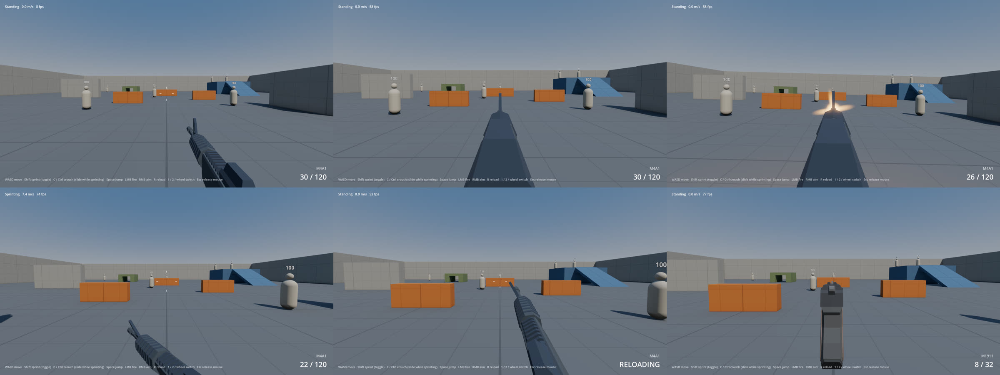

# Shooter

A multiplayer first-person shooter built on Godot 4.7, with gameplay code written in Rust. It runs on the Forward+ renderer with Jolt physics.

The plan, decisions, and reference projects are in [docs/roadmap.md](docs/roadmap.md). Open tasks for contributors are in [TODO.md](TODO.md).




## Layout

- `godot/`: the Godot project (scenes, GDScript glue, assets).
- `godot/data/weapons/`: one RON file per weapon (damage, fire rate, recoil pattern, spread, reload style, pellets, scope). Edit a file while the game runs from a debug build and it reloads.
- `rust/sim/`: engine-independent, deterministic simulation: movement, weapons (fire rate, falloff, recoil patterns, spread, pellets, bolt and pump cycling, magazine and shell-by-shell reloads, ADS, scope sway and hold breath, switching, pickups), health (regeneration, fall damage, death), the combined per-player step that netcode will predict, and gamepad look (stick shaping, aim assist). No Godot types, so the client and the dedicated server share it and it can be unit-tested on its own.
- `rust/game/`: the GDExtension that exposes the simulation to Godot: `FpsPlayer` (input, gamepad look and aim assist, hitscan, tracers, footsteps, camera), `AimAssistTarget`, `ViewmodelRig` and `WeaponView` (procedural weapon motion, muzzle flash, ejected shells, sounds), `WeaponPickup` (weapon racks), `Sentry` (a turret that shoots back), and `TargetDummy`.
- `godot/shaders/`: viewmodel projection (own FOV, never clips walls), muzzle flash, damage vignette, and the blockout grid.
- `godot/scripts/`: GDScript for the HUD, scope and damage overlays, pause and settings menu (`Settings` autoload), impacts, and tracers.
- `docs/`: roadmap and design notes.
- `tools/build_weapon_audio.py`: builds the layered gunshot sounds from bart's CC0 firearm library and trims dead air from the other sounds. Run it with `uv run`; its docstring explains the steps.

## Set up a Linux playtest machine

1. Install a current GPU driver with Vulkan support (NVIDIA proprietary driver, or Mesa for AMD and Intel). `vulkaninfo --summary` should list your GPU.
2. Install Rust: `curl --proto '=https' --tlsv1.2 -sSf https://sh.rustup.rs | sh`.
3. Install Godot 4.7.2 (standard build, no .NET) from the [4.7.2 release page](https://github.com/godotengine/godot/releases/tag/4.7.2-stable). Unzip it and put the binary on your PATH as `godot`.

## Build and run

Requirements: Godot 4.7.2+ (standard build, no .NET), a stable Rust toolchain, and [Git LFS](https://git-lfs.com) (models, textures, and audio are stored in LFS). Run `git lfs install` once before you clone, or `git lfs pull` in an existing clone.

```sh
cd rust && cargo build          # builds rust/target/debug/libshooter_game.*
cd .. && godot --path godot     # run the game
godot --editor --path godot     # open the editor
```

Rebuild with `cargo build` after changing Rust code. The editor hot-reloads the extension.

## Test

```sh
cd rust && cargo test && cargo clippy --all-targets
cd .. && godot --headless --path godot --script res://tests/smoke_test.gd
godot --headless --path godot --script res://tests/settings_test.gd
```

The smoke test loads the arena headless and drives the player through movement (toggle sprint, slide, crouch), combat (aim, fire, kill a dummy, reload, switch), a weapon rack, the shotgun (pellets, pump, shell-by-shell reload), the sniper (scope, hold breath), damage, regeneration, death and respawn, fall damage, the sentry, and gamepad look with aim assist. The settings test checks the menu and that settings save and load. Both exit non-zero on failure.

GDScript is linted and formatted with [gdtoolkit](https://github.com/Scony/godot-gdscript-toolkit):

```sh
uvx --from gdtoolkit==4.5.0 gdformat godot/scripts godot/tests
uvx --from gdtoolkit==4.5.0 gdlint godot/scripts godot/tests
```

To review visuals, capture a set of first-person screenshots (every weapon at the hip and aimed, firing, sprint, reload, shotgun pump, sniper scope, tracers, impacts, racks, damage, death). This needs a GPU:

```sh
CAPTURE_DIR=/tmp/shots godot --path godot --resolution 1600x900 --script res://tests/capture_screens.gd
```

## CI and builds

GitHub Actions runs two workflows:

- **CI** (`.github/workflows/ci.yml`) runs on every pull request and push to `main`: `cargo fmt` and `clippy -D warnings`, `cargo test` on Linux, Windows, and macOS, gdlint and gdformat, and the headless smoke test against Godot 4.7.2.
- **Build** (`.github/workflows/build.yml`) exports playable clients on every pull request and every push to `main`: Linux, Windows, and universal macOS zips appear as artifacts on the workflow run, so you can play a PR before it merges. The macOS app is ad-hoc signed, not notarized, so macOS asks before opening it. Pushing a `v*` tag publishes the zips as a GitHub Release.

To cut a release:

```sh
git tag v0.1.0 && git push origin v0.1.0
```

Export presets are in `godot/export_presets.cfg`. The Rust library for each platform is built on that platform's runner, then one Linux job exports all clients with Godot's export templates.

## Controls

| Action | Input |
| --- | --- |
| Move / look | WASD / mouse |
| Sprint (toggle; ends when you stop moving forward, fire, or aim) | Shift |
| Crouch (toggle; slides while sprinting) | C or Ctrl |
| Jump | Space |
| Fire / aim down sights | Left / right mouse |
| Hold breath (while scoped) | Shift |
| Take weapon or refill ammo at a rack | F |
| Reload | R |
| Switch weapon | 1, 2, or mouse wheel |
| Refill all ammo to max (demo) | T |
| Pause menu and settings | Esc |
| Show or hide the controls line | F1 |

Gamepads work too (Xbox layout shown; PlayStation and others use the same positions):

| Action | Input |
| --- | --- |
| Move / look | Left stick / right stick |
| Sprint (toggle) | L3 (click the left stick) |
| Crouch (toggle; slides while sprinting) | B |
| Jump | A |
| Fire / aim down sights | RT / LT |
| Reload | X |
| Switch weapon | Y |

On a gamepad, aim assist slows the right stick near a target and follows part of the target's movement relative to you while you move or look. It never snaps to a target, and the mouse never gets it. The HUD switches its controls hint to whichever device you used last. Stick speed, deadzones, response curve, invert Y, aim assist, and rumble are exported properties on the `Player` node; the settings menu does not show them yet.

The arena has target dummies at several ranges. They show their health and respawn 3 seconds after being killed. Weapon racks next to the spawn hold every weapon; walk up and press F to swap. The sentry on the raised platform shoots at you when you come within 32 m and can see it; shoot it to knock it out for 10 seconds.

## Weapons

| Weapon | Type | Notes |
| --- | --- | --- |
| M4A1 | Assault rifle | 750 RPM, 4-shot kill up close |
| AK-47 | Assault rifle | 600 RPM, 3-shot kill up close, stronger recoil |
| PDW-9 | SMG | 900 RPM, damage falls off early, red dot |
| M870 | Pump shotgun | 8 pellets, one-shot kill up close, loads shell by shell (fire to interrupt) |
| M40 | Bolt-action sniper | One-shot chest kill, 3.5x scope that sways; hold Shift to steady it |
| M1911 | Pistol | Semi-automatic sidearm |

Exported builds must include `*.ron` in the export preset's non-resource filter so the weapon files are packed.

## Assets

Placeholder art and audio are CC0. Sources are listed in [godot/assets/CREDITS.md](godot/assets/CREDITS.md).
